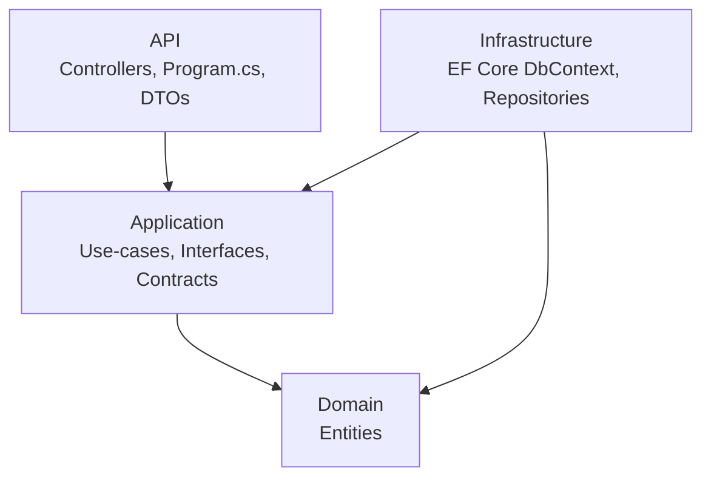

# NET_Backend

A .NET 10 ASP.NET Core Web API built on **Clean Architecture** (Onion layers). Dependencies point inward only, so business rules stay independent of frameworks, databases, and transport concerns.

---

## Architecture



### Dependency rule

> Dependencies point **inward only**.
> `API → Application → Domain`
> `Infrastructure → Application → Domain`
> Nothing in `Domain` or `Application` references `Infrastructure` or `API`.

### Layers

| Layer | Project (folder) | Namespace root | Responsibilities |
|---|---|---|---|
| **Domain** | `Domain.csproj` (`Entities/`) | `Domain` | Entities, value objects, domain interfaces. No EF Core, HTTP, or JSON. |
| **Application** | `Application.csproj` (`Services/`) | `Application` | Use-cases (`UserService`), service interfaces (`IUserService`), repository contracts (`IUserRepository`). |
| **Infrastructure** | `Infrastructure.csproj` (`Repository/`) | `Infrastructure` | EF Core `LearningAppDbContext`, repository implementations (`UserRepository`). |
| **API** | `API.csproj` (`API/`) | `API` | Controllers, DTOs, middleware, DI wiring in `Program.cs`. |

> Note: physical folder names differ from logical project names (e.g. the `Entities/` folder contains the `Domain` project, `Services/` contains `Application`, `Repository/` contains `Infrastructure`).

---

## Project structure

```
NET_Backend/
├── API/                        # Entry point (API project)
│   ├── Controllers/            # UserController, WeatherForecastController
│   ├── DTOs/UserDTO/           # UserCreateDto, UserReadDto
│   ├── Program.cs              # DI, EF Core, Swagger, pipeline
│   ├── appsettings.json        # Connection strings & config
│   └── API.slnx                # Solution file
├── Entities/                   # Domain project
│   └── Entities/User.cs
├── Services/                   # Application project
│   ├── Contracts/IUserRepository.cs
│   ├── Interfaces/IUserService.cs
│   └── UseCases/UserService.cs
├── Repository/                 # Infrastructure project
│   ├── Data/LearningAppDbContext.cs
│   └── Repositories/UserRepository.cs
└── DevContext.md               # Team conventions & best practices
```

---

## Tech stack

- **.NET 10** / ASP.NET Core Web API
- **Entity Framework Core 10** (SQL Server / LocalDB)
- **Swagger / OpenAPI** via `Swashbuckle.AspNetCore`

---

## Getting started

### Prerequisites

- [.NET 10 SDK](https://dotnet.microsoft.com/download)
- SQL Server **LocalDB** (or update the connection string for your own SQL Server)
- EF Core CLI tools: `dotnet tool install --global dotnet-ef`

### Configure the database

The default connection string lives in [API/appsettings.json](API/appsettings.json):

```json
"ConnectionStrings": {
  "DefaultConnection": "Server=(localdb)\\MSSQLLocalDB;Database=LearningAppDb;Trusted_Connection=True;MultipleActiveResultSets=true;TrustServerCertificate=True"
}
```

### Build & run

```powershell
# Restore & build the whole solution
dotnet build API/API.slnx

# Run the API
dotnet run --project API/API.csproj
```

The API listens on:

- HTTP: `http://localhost:5030`
- HTTPS: `https://localhost:7065`

### Swagger UI

Once running, open:

```
http://localhost:5030/swagger
```

- OpenAPI document: `GET /swagger/v1/swagger.json`

---

## API endpoints

| Method | Route | Description | Success |
|---|---|---|---|
| `GET` | `/api/users/ping` | Health / smoke-test endpoint | `200 OK` |
| `POST` | `/api/users` | Create a user | `201 Created` |

### Example: create a user

```http
POST /api/users
Content-Type: application/json

{
  "firstName": "Ana",
  "lastName": "Pop",
  "email": "ana.pop@example.com"
}
```

---

## Database migrations (EF Core)

Migrations are managed from the **Infrastructure** project with the **API** project as the startup:

```powershell
# Add a migration
dotnet ef migrations add InitialCreate --project Repository/Infrastructure.csproj --startup-project API/API.csproj

# Apply migrations to the database
dotnet ef database update --project Repository/Infrastructure.csproj --startup-project API/API.csproj
```

---

## Conventions

Team conventions, REST design rules, naming standards, validation, and error-handling patterns are documented in [DevContext.md](DevContext.md). Treat every rule there as a first-class constraint.
